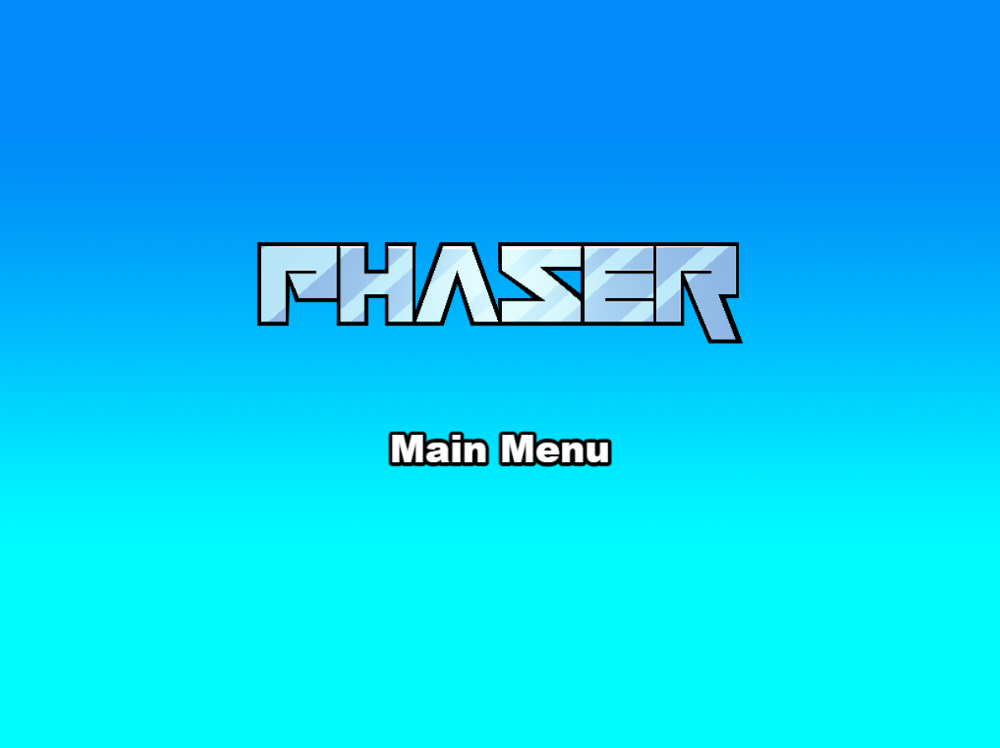

# 🎸 FretZen

Un petit jeu web pour apprendre les notes du manche de guitare, en s'amusant.

Une note apparaît (par exemple `E`). Trouve-la sur le manche et éclate la feuille
correspondante. Vide le manche pour gagner — le plus vite possible !

Construit avec **Phaser 4**, **TypeScript** et **Vite**.



## Démarrer

```bash
npm install
npm run dev     # → http://localhost:8080
```

Et voilà, c'est parti 🌱

## Comment jouer

1. Choisis un **mode** : 10, 15 ou 20 feuilles (chacun garde son record).
2. Une note cible s'affiche en grand. **Toutes** les feuilles de cette note sont
   valides, quelle que soit l'octave.
3. Clique sur la bonne feuille : elle éclate, la note résonne, la suivante arrive.
4. Un mauvais clic ? Juste une petite secousse, rien n'est supprimé.
5. Vide le manche pour gagner. Le chrono s'arrête et ton record se met à jour.

🔊 Le haut-parleur (en haut à droite) coupe le son. ⏸ `Échap` ou `P` mettent en
pause.

## Les commandes utiles

| Commande | Description |
|----------|-------------|
| `npm run dev` | Serveur de développement |
| `npm run build` | Build de production dans `dist/` |
| `npm test` | Tests unitaires (Vitest) |
| `npm run typecheck` | Vérification TypeScript |

> Les variantes `dev-nolog` / `build-nolog` font la même chose sans le ping
> anonyme du template Phaser (voir `log.js`).

## Sous le capot

- **Logique séparée du rendu.** Toute la musique et les règles du jeu vivent dans
  [`src/domain/`](src/domain/), sans aucune dépendance à Phaser — donc testables
  isolément. Les hauteurs sont calculées via les numéros MIDI, jamais codées à la
  main.
- **Rendu Phaser** dans [`src/game/`](src/game/) : scène, feuilles, audio, thème.
- **Audio synthétisé** en Web Audio : aucun fichier, aucune licence.
- **Records** sauvegardés dans `localStorage`, par mode.
- **TypeScript strict**, sans `any`.

```text
src/
  domain/   # logique pure, testée (notes, manche, génération, état)
  game/     # Phaser : scène, feuilles, audio, thème
  main.ts   # bootstrap
```

Plus de détails dans [`documentation/`](documentation/) et [`SPEC.md`](SPEC.md).

## Bon à savoir

- Pensé pour le **desktop** (pas encore optimisé mobile/tactile).
- Le chrono tourne en temps réel : changer d'onglet compte dans le temps final.
- La cible est une **classe de note** (sans octave) : toute position de cette
  note est acceptée — un choix plus pédagogique pour mémoriser le manche.

## Crédits

Basé sur le template officiel
[`template-vite-ts`](https://github.com/phaserjs/template-vite-ts) de Phaser
Studio. Sous licence MIT.
